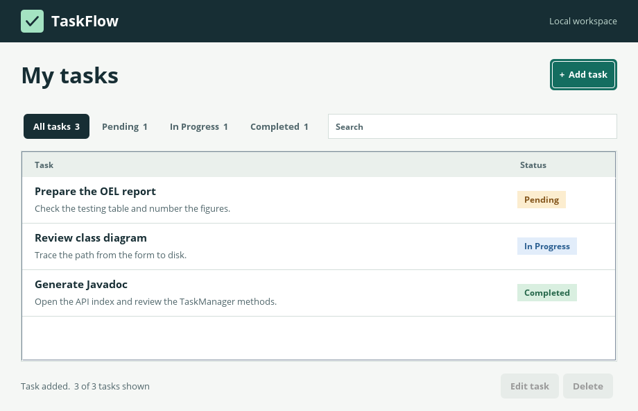

# TaskFlow

A Java 17 desktop task manager for the Software Construction Open-Ended Lab at MCS, NUST (BESE-30 C). Group members are Haifa Khan Afridi and Emman Khattak.

## Run in Eclipse

1. Install a full JDK 17 and Eclipse IDE for Java Developers.
2. In Eclipse, open **Window → Preferences → Java → Installed JREs**. Add the JDK 17 home directory as a **Standard VM** and select it. Under **Execution Environments**, associate **JavaSE-17** with that JDK.
3. Choose **File → Import → General → Existing Projects into Workspace**. Select the folder containing this README and the `.project` file. Tick **TaskFlow** and select **Finish**.
4. In **Package Explorer**, expand **TaskFlow → src → taskflow**, right-click **TaskFlow.java** and choose **Run As → Java Application**.
5. To debug, open `TaskFlow.java`, double-click the left margin beside `SwingUtilities.invokeLater(TaskFlow::open);`, then use **Debug As → Java Application**. Press **F8** to resume when execution stops there.

## Run from a terminal

Start in the folder containing this README. A full JDK supplies `java`, `javac` and `javadoc`. Check all three with `java -version`, `javac -version` and `javadoc --version`.

| Action | Windows PowerShell | Git Bash, macOS or Linux |
|---|---|---|
| Launch | `.\taskflow.cmd run` | `bash taskflow.sh run` |
| Test the model and storage | `.\taskflow.cmd test` | `bash taskflow.sh test` |
| Test the actual desktop window | `.\taskflow.cmd ui-test` | `bash taskflow.sh ui-test` |
| Capture desktop test screenshots | `.\taskflow.cmd ui-test evidence` | `bash taskflow.sh ui-test evidence` |
| Regenerate the HTML documentation | `.\taskflow.cmd docs` | `bash taskflow.sh docs` |

The scripts compile the source before each action. Desktop execution and the UI suite require a graphical session. The command-line and Eclipse checks recorded here were executed on Linux with JDK 17.

## Use the workspace

Choose **+ Add task**, enter a title, optionally add notes, pick a status and save. New tasks default to **Pending**. Select a row and use **Edit task** to change its details or stage. Double-clicking a row also opens it. **Delete** identifies the selected task and asks for confirmation. **Cancel** is the default in that dialog.

Type in **Search** to match titles or descriptions. Click a status tab to narrow the list. Its number counts every task in that stage. The footer counts the visible rows. Adding a task clears both filters and selects the new row. Editing keeps the current filter.

## Local storage

The application saves each successful operation in `.taskflow/tasks.properties` under the current user's home directory. Use a local, writable directory for the workspace. The store locks the directory while it is open and replaces the saved file with an atomic rename. Each task has a UUID independent of its title.

To run a separate demo after compiling, use `java -Dtaskflow.dir=demo-workspace -cp out taskflow.TaskFlow`. Tests create and remove their own temporary workspaces. If the application reports an invalid data file, keep the original and open a separate demo workspace while inspecting it.

## Source and evidence

| Path | Purpose |
|---|---|
| `src/taskflow` | Application entry point, Swing views, business logic and storage |
| `test/taskflow` | Two executable test suites using standard Java |
| `docs/api/index.html` | Generated Javadoc entry point. Open in a browser and select a class. |
| `docs/TESTING.md` | Test inputs, expected behavior, observed output and results |
| `docs/verification.txt` | Recorded compiler, IDE, test and browser checks |

## Clone a published repository

Open **Code → HTTPS** on the published GitHub project. Copy its clone URL. Run `git clone "PASTE_THE_COPIED_HTTPS_URL_HERE" TaskFlow`, replacing the quoted text, then `cd TaskFlow`. Use the Eclipse or terminal steps above. The submitted ZIP also includes a portable Git bundle alongside the source folder. The companion guide explains how to restore the original history and push it to an empty GitHub repository.
